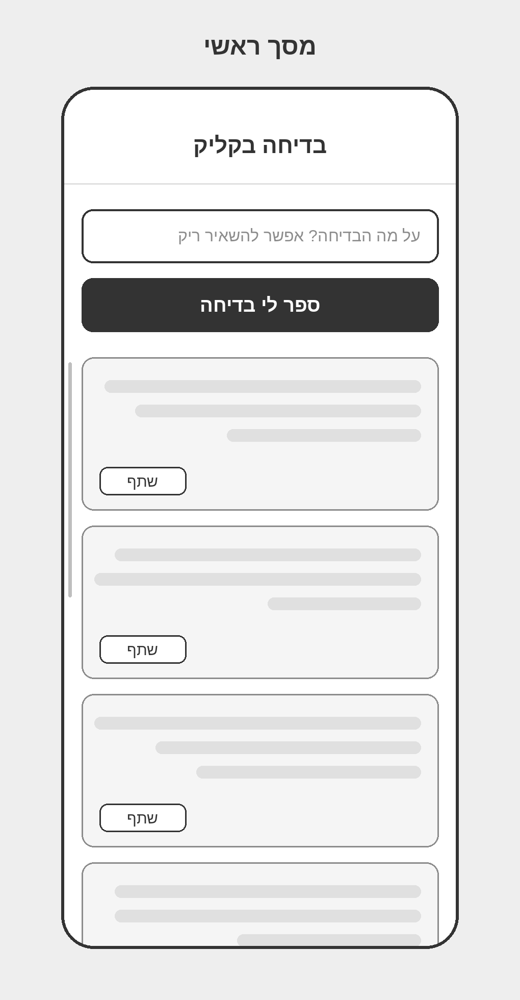
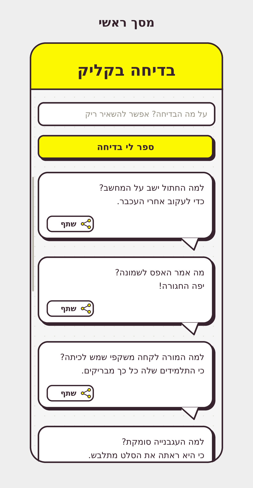
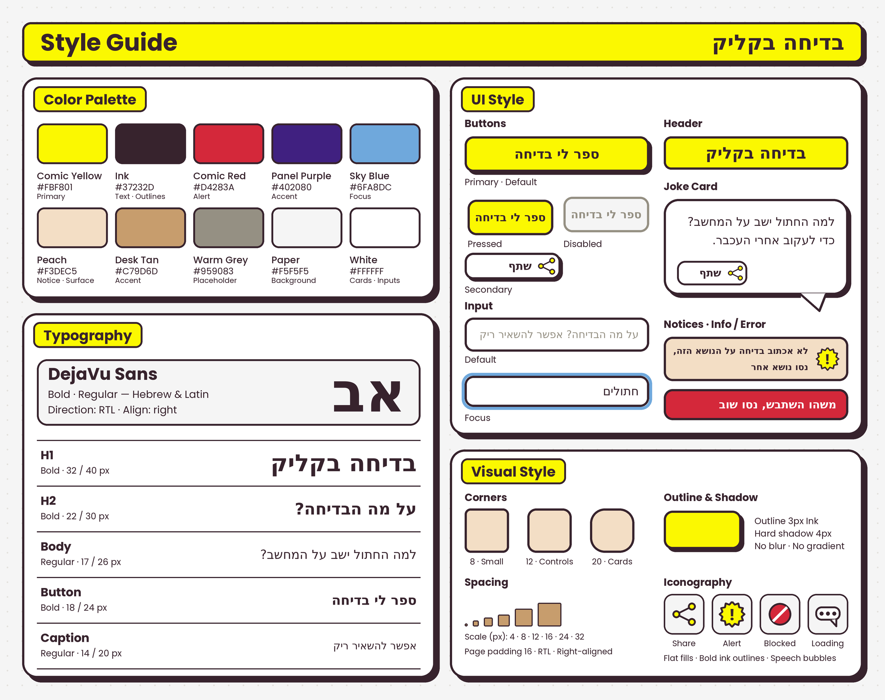

# DESIGN – בדיחה בקליק

מסמך זה מתאר את המימוש העיצובי של האפליקציה, על בסיס ה-Wireframes, ה-Style Guide וה-Mockups. דרישות המוצר והתנהגות המערכת מוגדרות ב-PRD.md ואינן חוזרות כאן.

**הערה על מידות:** התמונות מצוירות בקנה מידה של פי 2 ממסך ברוחב 390px. כל המידות במסמך הן ב-CSS px (כלומר חצי ממה שנראה בתמונה). ערכים שאינם כתובים במפורש ב-Style Guide אלא נמדדו מתוך ה-Mockups מסומנים כ"נגזר מה-Mockup".

---

## 1. Screens – מסכי האפליקציה

עסקית: המוצר כולו הוא פעולה אחת (נושא נכנס, בדיחה יוצאת), ולכן יש בו מסך אחד בלבד. כל מצבי המערכת (טעינה, חסימה, שגיאה) מוצגים על אותו מסך ואינם מסכים נפרדים.

### Wireframes

### Mockups

### מסך ראשי

**מטרת המסך:** להזין נושא (או להשאיר ריק), לקבל בדיחה, לראות את כל הבדיחות של השימוש הנוכחי ולשתף אותן.

**מבנה ותוכן** (מלמעלה למטה):

| אזור | תיאור |
|---|---|
| **Header** | פס צהוב (`#FBF801`) לכל רוחב המסך, גובה כ-95px (נגזר מה-Mockup), עם קו תחתון בצבע Ink בעובי 3px. במרכזו הכותרת "בדיחה בקליק" בסגנון H1 |
| **שדה נושא** | שדה קלט בגובה כ-48px (נגזר מה-Mockup), רקע לבן, מסגרת Ink בעובי 3px, רדיוס 12px. Placeholder: "על מה הבדיחה? אפשר להשאיר ריק" בצבע Placeholder Grey, מיושר לימין |
| **כפתור ראשי** | כפתור צהוב ברוחב השדה, גובה כ-48px (נגזר מה-Mockup), מסגרת Ink 3px, רדיוס 12px, צל קשיח 4px. טקסט: "ספר לי בדיחה" בסגנון Button, במרכז |
| **רשימת הבדיחות** | עמודה אנכית של כרטיסי בדיחה, כל חדש מתחת לקודמים, במרווח אנכי של כ-20px בין כרטיסים (נגזר מה-Mockup). רק הרשימה גוללת |

**גלילה:** ה-Header, שדה הנושא, הכפתור ואזור ההודעות קבועים בראש המסך ואינם זזים. רק רשימת הבדיחות גוללת, באזור שמתחתם (כמו ב-Mockup, שבו פס הגלילה מתחיל בגובה הרשימה). כך הכפתור וההודעות תמיד נראים, גם אחרי בדיחות רבות.

**התנהגות אחרי בקשה:** הנושא נשאר בשדה אחרי שהתקבלה בדיחה, כדי שאפשר יהיה לבקש עוד אחת על אותו נושא. הודעה (חסימה או שגיאה) נשארת מוצגת עד הבקשה הבאה, ונעלמת ברגע הלחיצה הבאה על הכפתור.

**כרטיס בדיחה (Joke Card):** בועת דיבור לבנה, רדיוס 20px, מסגרת Ink 3px, צל קשיח 4px.
- טקסט הבדיחה בסגנון Body, מיושר לימין, עם ריווח פנימי של כ-18px (נגזר מה-Mockup).
- כפתור "שתף" (Secondary) בפינה השמאלית התחתונה של הכרטיס, ובו האייקון Share מימין לתווית "שתף".
- זנב הבועה בפינה הימנית התחתונה, מחוץ לגוף הכרטיס.
- בתחתית המסך הכרטיס הבא נחתך באמצע, כרמז לכך שאפשר לגלול. בצד שמאל של הרשימה מופיע פס גלילה דק באפור.

**פעולות וניווט:**
- הקלדה בשדה הנושא. בזמן ההקלדה לשדה מסגרת Focus (ראו Style Guide).
- לחיצה על "ספר לי בדיחה" מוסיפה כרטיס חדש בתחתית הרשימה.
- לחיצה על "שתף" בכרטיס פותחת את תפריט השיתוף של המכשיר.
- גלילה ברשימה.
- אין מעבר למסכים אחרים.

**מצבים על אותו מסך:**

| מצב | מראה |
|---|---|
| כפתור לחוץ | אותו צבע, מוזז כ-4px למטה ולימין, ללא צל |
| כפתור מושבת | רקע Paper, מסגרת וטקסט בצבע Warm Grey, ללא צל. מיועד לזמן שבקשה בעיצומה |
| טעינה | האייקון Loading (בועת דיבור עם שלוש נקודות) מייצג בקשה פעילה. מופיע במקום הכרטיס הבא, בתחתית הרשימה, והרשימה גוללת אליו |
| הודעת חסימה | רכיב Notice (Info): רקע Peach, מסגרת Ink 3px, רדיוס 12px, האייקון Alert מימין, טקסט מודגש מיושר לימין. נוסח לפי טבלת "נוסחי ההודעות" |
| הודעת שגיאה | רכיב Notice (Error): רקע Comic Red, מסגרת Ink 3px, טקסט לבן מודגש. נוסח לפי טבלת "נוסחי ההודעות" |
| הודעות בכלל | מוצגות בין כפתור היצירה לרשימה, בתוך האזור הקבוע בראש המסך |

**נוסחי ההודעות (סופיים):**

| מצב | רכיב | נוסח |
|---|---|---|
| נושא רגיש או אסור | Notice – Info | לא אכתוב בדיחה על הנושא הזה, נסו נושא אחר |
| כל תקלה (המודל אינו זמין, אין חיבור, תשובה לא תקינה, קלט לא תקין) | Notice – Error | משהו השתבש, נסו שוב |

### מבנה הניווט הכללי

אין ניווט בין מסכים. האפליקציה נפתחת ישירות במסך הראשי, גם כשהיא מותקנת כ-PWA במסך מלא.

---

## 2. Style Guide – השפה העיצובית

עסקית: השפה החזותית לקוחה מעולם הקומיקס כדי לתמוך בטון ההומוריסטי של המוצר: קווי מתאר עבים, צבעים שטוחים ובועות דיבור. הצבעים נדגמו מתמונת ה-Inspiration Board.

### Color Palette

| שם | HEX | שימוש |
|---|---|---|
| Comic Yellow | `#FBF801` | צבע ראשי: Header, כפתור ראשי |
| Ink | `#37232D` | טקסט וקווי מתאר |
| Comic Red | `#D4283A` | הודעת שגיאה |
| Panel Purple | `#402080` | צבע מבטא |
| Sky Blue | `#6FA8DC` | טבעת Focus בשדה הקלט |
| Peach | `#F3DEC5` | הודעות מידע ומשטחים |
| Desk Tan | `#C79D6D` | צבע מבטא |
| Warm Grey | `#959083` | רכיבים מושבתים |
| Placeholder Grey | `#706B60` | טקסט ה-Placeholder בשדה הקלט. גוון כהה יותר של Warm Grey, כדי שהטקסט יהיה קריא (ניגודיות כ-5:1 על לבן, לעומת כ-3:1 ב-Warm Grey) |
| Paper | `#F5F5F5` | רקע המסך |
| White | `#FFFFFF` | כרטיסים ושדות קלט |

הערה: ב-Mockup אין שימוש ב-Panel Purple וב-Desk Tan. הם מוגדרים כצבעי מבטא לשימוש עתידי, ואין להוסיף אותם למסך הראשי.

### Typography

- **גופן:** DejaVu Sans (Bold ו-Regular), תומך בעברית ובלטינית. כך מוצג ב-Style Guide וב-Mockups. אם יוחלף בעתיד בגופן עברי בסגנון דומה, יש לשמור על ההיררכיה והגדלים שלהלן.
- **כיוון ויישור:** RTL, טקסט מיושר לימין.

| רמה | משקל | גודל / גובה שורה | דוגמה | שימוש |
|---|---|---|---|---|
| H1 | Bold | 32 / 40 px | בדיחה בקליק | כותרת ה-Header |
| H2 | Bold | 22 / 30 px | על מה הבדיחה? | כותרת משנה (מוגדרת ב-Style Guide, ללא שימוש ב-Mockup) |
| Body | Regular | 17 / 26 px | למה החתול ישב על המחשב? | טקסט הבדיחה, טקסט בשדה הקלט (16px, נגזר מה-Mockup) |
| Button | Bold | 18 / 24 px | ספר לי בדיחה | תווית הכפתור הראשי (תווית "שתף" ו-Notice בגודל כ-15px ו-12–14px, נגזר מה-Mockup) |
| Caption | Regular | 14 / 20 px | אפשר להשאיר ריק | טקסט עזר |

צבע טקסט: Ink על רקעים בהירים וצהובים. לבן רק על רקע Comic Red. ה-Placeholder בצבע Placeholder Grey.

### UI Style

| רכיב | מפרט |
|---|---|
| **Primary Button** | רקע Comic Yellow, מסגרת Ink 3px, רדיוס 12px, צל קשיח 4px. מצבים: Default, Pressed (מוזז 4px, ללא צל), Disabled (Paper, Warm Grey, ללא צל) |
| **Secondary Button** | רקע לבן, מסגרת Ink 3px (בכרטיס: 2.5px, נגזר מה-Mockup), רדיוס 11–12px. תווית Bold מימין לאייקון Share, האייקון בצד ימין |
| **Input** | רקע לבן, מסגרת Ink 3px, רדיוס 12px. מצב Focus: טבעת Sky Blue בעובי 4px סביב המסגרת, בהפרש של כ-4px (נגזר מה-Style Guide) |
| **Header** | רקע Comic Yellow, מסגרת תחתונה Ink 3px, כותרת H1 במרכז |
| **Joke Card** | רקע לבן, רדיוס 20px, מסגרת Ink 3px, צל קשיח 4px, זנב בועת דיבור בפינה הימנית התחתונה |
| **Notice – Info** | רקע Peach, מסגרת Ink 3px, רדיוס 12px, אייקון Alert מימין |
| **Notice – Error** | רקע Comic Red, מסגרת Ink 3px, רדיוס 12px, טקסט לבן מודגש |
| **Icons** | ארבעה אייקונים: Share, Alert, Blocked, Loading. קו מתאר Ink עבה (כ-2.5px), מילוי שטוח: צהוב ל-Share ול-Alert, אדום ל-Blocked, לבן ל-Loading |

תפריטים ורכיבי ניווט אינם קיימים באפליקציה.

### אייקון האפליקציה וצבעי האפליקציה המותקנת

- **אייקון:** בועת דיבור בצבע Comic Yellow עם קו מתאר Ink עבה ושלוש נקודות Ink בתוכה (כמו אייקון ה-Loading), על רקע Paper. מילוי שטוח, ללא צל וללא טקסט, בסגנון האייקונים שב-Style Guide.
- **Maskable:** גרסה שבה הבועה ממוקמת במרכז האזור הבטוח (כ-80% מהשטח), כדי שלא תיחתך כשמערכת ההפעלה מעגלת את האייקון.
- **צבע נושא (`theme_color`):** Comic Yellow `#FBF801`, כמו ה-Header.
- **צבע רקע (`background_color`):** Paper `#F5F5F5`, רקע מסך הפתיחה של האפליקציה המותקנת.

### Visual Style

- **צורות ופינות:** פינות מעוגלות בשלוש רמות: 8px (אלמנטים קטנים), 12px (כפתורים, שדות והודעות), 20px (כרטיסים).
- **קווי מתאר:** Ink בעובי 3px על כל הרכיבים. אין קו מתאר בצבע אחר, מלבד Warm Grey ברכיב מושבת וטבעת ה-Focus הכחולה.
- **צללים:** צל קשיח בהיסט של 4px ימינה ולמטה, בצבע Ink, ללא טשטוש וללא גרדיאנט. נושאים צל: כפתור ראשי וכרטיס בדיחה. כפתור לחוץ מאבד את הצל.
- **מרווחים (Spacing):** סולם 4, 8, 12, 16, 24, 32px. ריווח צדדי של המסך: 16px.
- **רקע:** Paper עם רשת נקודות עדינה (כמו בלוח ההשראה). הנקודות בגוון בהיר מעט מ-Paper.
- **אייקונוגרפיה ואיור:** מילויים שטוחים, קווי מתאר עבים בצבע Ink, ומוטיב בועת הדיבור. אין תמונות, צילומים או איורים נוספים.
- **אווירה:** קומיקס שובב ובהיר, עם ניגודיות חזקה בין הצהוב לצבע הדיו.

### שפה וכיווניות

- שפת הממשק: עברית. כיווניות RTL בכל המסך.
- טקסטים מיושרים לימין. תיבת הנושא מתחילה מימין.
- בכרטיס בדיחה: הטקסט בימין, כפתור "שתף" בשמאל למטה, אייקון Share מימין לתווית.
- זנב הבועה בפינה הימנית התחתונה. פס הגלילה בצד שמאל.
- הכותרת במרכז ה-Header, ותווית הכפתור הראשי במרכזו.
